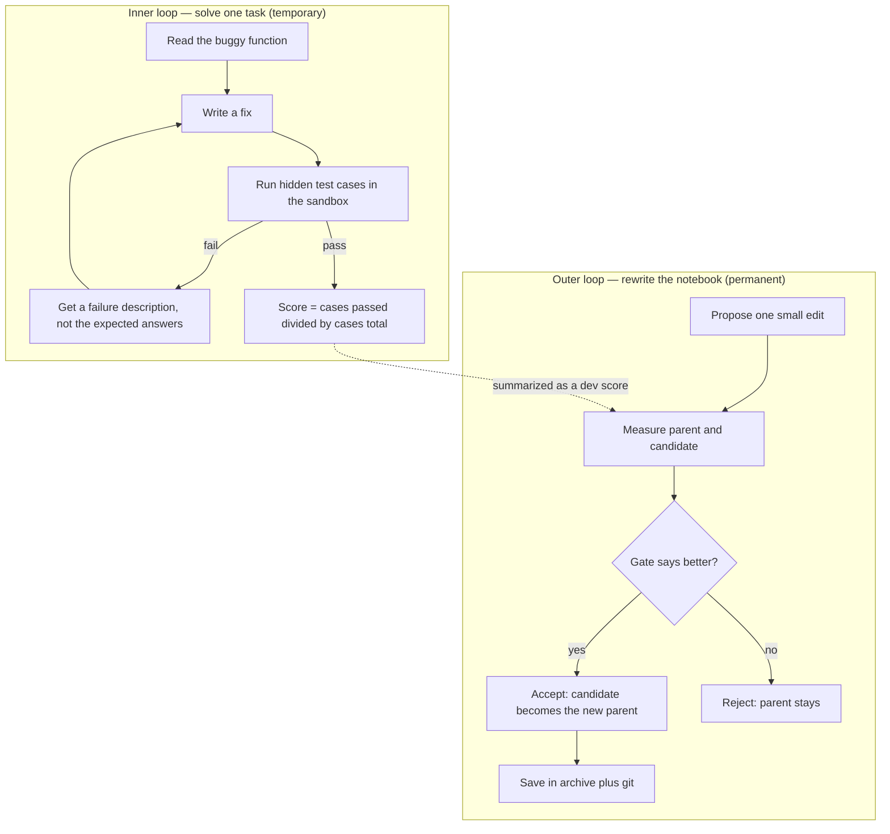
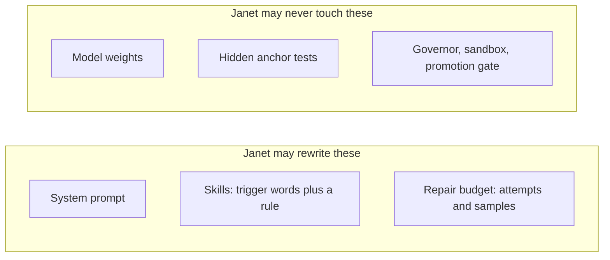
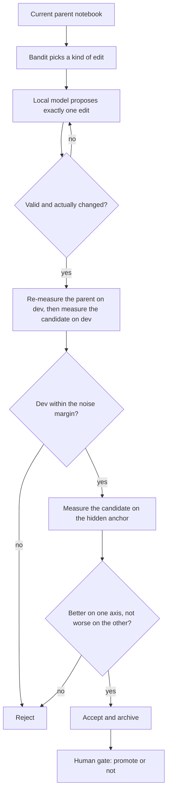
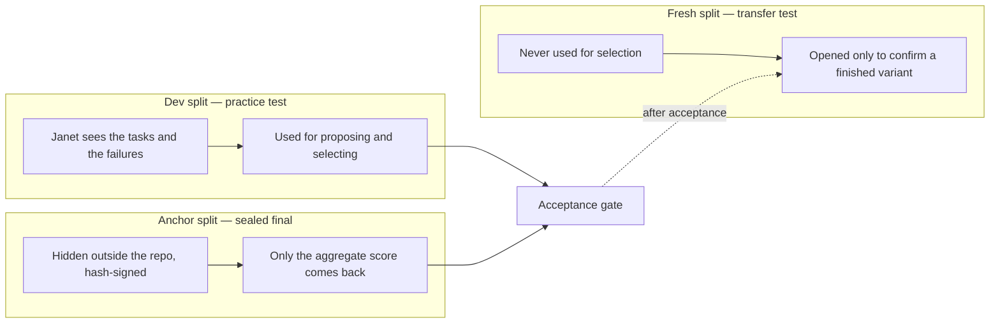

# How Janet learns and evolves

**Last updated:** 2026-10-26
**Kind:** explainer + status snapshot (not a plan)
**Revision:** public baseline of 2026-10-26, including bandit reward v2
**Status:** mechanism is built; transfer is not demonstrated
**Audience:** anyone asking "what is actually evolving here?"

---

## The short version

Janet does **not** retrain the model. The model's brain is frozen. What changes
is the **notebook around the brain**: its instructions, its small library of
rules, and how many tries it gets.

That notebook is the thing that evolves. Each generation Janet makes **one small
edit**, tests it, and keeps it only if the tests say it helped. Variation,
selection, memory — that is evolution.

---

## What exactly changes?

The mutable notebook is a `HarnessSpec` in `src/janet/harness/spec.py`:

| Field | Limit | Meaning |
|---|---|---|
| `system_prompt` | 40–4000 chars | the standing instruction to the model |
| `skills` | max 6 | each is a name, 1–5 trigger words, and a 20–400 char rule |
| `max_attempts` | 1–5 | how many repair rounds per task |
| `samples_per_attempt` | 1–4 | how many candidates per round; the verifier picks the best |

Every behavior-affecting field is hashed, so each variant has an identity, and
its parent is recorded. That is what makes a family tree possible. `name`,
`parent`, and `mutation_note` are lineage metadata, not part of the hash.

The immutable parts are the safety boundary: `src/janet/governor.py`,
`src/janet/sandbox.py`, the anchor tests outside the repo, and the human
promotion gate.

---

## The inner loop: solving one task

1. Janet gets a task: a broken Python function plus test cases it cannot see.
2. The model returns code.
3. The verifier runs the code in a `bubblewrap` sandbox with no network and a
   read-only root (`src/janet/eval/runner.py`).
4. The score is simply **fraction of test cases passed**. The program decides,
   not the model.
5. If it fails, Janet is told *what went wrong* — but not the expected outputs —
   and tries again, up to the notebook's attempt limit
   (`src/janet/eval/repair.py`).

Integrity tasks are the exception: the correct answer is `ABSTAIN: <reason>`.
Fabricating an answer fails. This keeps "confidently make something up" from
scoring as skill.

This is learning only in the moment. When the task ends, nothing is remembered
from it. Persistence happens in the outer loop.

---

## The outer loop: one generation

In plain words (`src/janet/loop/generation.py`):

- **Parent** = the latest accepted notebook. The archive calls this a greedy
  hill-climb: lineage moves forward only on verified improvement.
- **Idea** = the local model proposes one change: rewrite the prompt, add a
  skill, change the budget, or prompt + skill together.
- **Checks** (`src/janet/harness/mutate.py`): the edit must actually change
  behavior; it may not name a benchmark task or function; a new skill's trigger
  words must really appear in task text, otherwise the skill is "inert" and
  would never fire.
- **Paired test**: re-measure the parent *now*, then the candidate. This stops
  Janet from comparing against the parent's lucky past score.
- **Gate**: accept if dev improved and the anchor did not regress, **or** the
  anchor improved while dev stayed within a small noise allowance
  (`loop.dev_margin`, default 0.03). If dev falls outside the margin, the anchor
  is not measured and the candidate is rejected.
- **Memory**: every variant goes into SQLite plus a nested git repo
  (`src/janet/harness/archive.py`). Accepted variants form the lineage; rejected
  ones remain in the record.
- **Promotion is human**: `loop.promote = false` by default. Janet proposes; a
  person promotes with `janet archive promote <hash>`. Promotion writes
  `current.json` in the archive; `janet archive rollback` returns the previously
  promoted spec.

On the **anchor**, the candidate gets one shot with no repair feedback. That is
deliberate: it measures whether the notebook generalizes, and it stops hidden
test inputs from leaking back into the loop.

---

## Why it cannot just fool itself

Four protections matter most:

1. **The anchor is hidden and outside the sandbox.** Janet sees its score, never
   its inputs or expected outputs. The anchor manifest is hash-checked, so a
   rematerialized or edited anchor invalidates comparisons.
2. **The fresh split is never used for selection.** It is only opened afterward
   to ask: "does this variant also win on tasks nobody tuned on?" The one-shot
   protocol is temperature 0, so a difference is a property of the notebook, not
   sampling luck.
3. **The decoupling detector** (`src/janet/loop/decoupling.py`) watches for the
   classic failure: dev scores climbing while held-out scores stay flat. When
   that happens, the gate turns strict and demands held-out improvement, not just
   dev improvement.
4. **Integrity tasks** reward honest abstention. Candidate code is also statically
   audited for network, subprocess, and `eval` before it runs
   (`src/janet/eval/audit.py`); the sandbox is the real boundary and the audit is
   a second, cheap layer that also records intent.

Additional anti-collusion rules in the evaluator-evolution pass
(`src/janet/eval/evolve.py`):

- The proposer returns **inputs only**; expected outputs always come from the
  trusted reference executed in the sandbox.
- An input is accepted only if it kills at least one reference mutant the suite
  so far does not (the mutation-kill gate).
- Cases are monotone: appended, never edited or removed.
- Only dev evolves. Anchor and fresh stay frozen as external grounding.

---

## Three layers of "learning"

| Layer | What changes | Does it persist? | Code |
|---|---|---|---|
| Inside a task | the candidate code | no | `src/janet/eval/repair.py` |
| A generation | prompt, skills, budget | yes — archive + git | `src/janet/loop/generation.py` |
| The evaluator | new dev test cases, monotone only, admitted only if they kill a known mutant | yes | `src/janet/eval/evolve.py` |
| The meta-level | which *kind* of edit pays off | yes — `runs/bandit.json` | `src/janet/harness/bandit.py` |
| The watchdog | whether dev still tracks held-out | changes gate strictness | `src/janet/loop/decoupling.py` |

That last row is the beginning of "learning how to learn": Janet is not just
changing the notebook, it is learning *which kind of edit usually works*. The
UCB1 bandit chooses among `prompt`, `skill`, `budget`, and `prompt+skill`, and
receives a reward shaped by the gate — never by the model's self-report.

Reward v2 (working tree, `REWARD_VERSION = 2`) uses the **held-out anchor**
score whenever both parent and candidate have one:

| Held-out delta | Accepted | Rejected |
|---|---:|---:|
| > +0.01 | +1.0 | +0.5 |
| within ±0.01 | +0.25 | 0.0 |
| < −0.01 | −0.25 | −0.5 |

Other outcomes: anchor not measured (dev-floor) −0.05, proposal error −0.25. The
fresh split is never used in the reward, or it would stop being an unbiased
confirmation set.

The plan's higher metric — is the *rate* of improvement itself improving
(`meta_improvement`, a slope with a bootstrap CI)? — is **not built yet**. The
operator bandit and the decoupling detector are the first two slices of P6; the
meta-slope is still a plan item.

---

## So, is it actually improving itself?

Honestly: **the instrument works; the transfer claim is not established yet.**
This is the central negative result of P3.2, P4, and P6 so far.

| Run | Generations | Accepted | Fresh-split delta | Verdict |
|---|---|---:|---:|---|
| P3.2 (2026-10-23) | 8 | 2 | 0.000 | no headroom; seed solved 5/6 fresh tasks |
| P4 (2026-10-25) | 6 | 1 (`d2a036af`) | −0.030 | anchor +0.017, no transfer |
| P6 overnight (2026-10-25/26) | 23 across 29 sessions | 1 new (`f978028f`) | −0.0296 | anchor +0.010, no transfer |

Both accepted variants remain archived but **not promoted**. The P6 bandit after
22 pulls:

| Arm | Pulls | Mean reward |
|---|---:|---:|
| `skill` | 9 | −0.183 |
| `prompt` | 6 | −0.350 |
| `budget` | 4 | −0.388 |
| `prompt+skill` | 3 | −0.500 |

All arm means are negative: the gate is rejecting most proposer hypotheses, and
the one acceptance did not transfer. The bottleneck is **proposer diversity**,
not the gate — every mutation is some form of "validate inputs" or "handle
exceptions". The bandit forces a focus but cannot invent a better hypothesis.

What has improved is the *instrument*: the mutation-kill gate made the dev
evaluator harder and more informative (mutation score 0.686 → 0.737, and
`date_add_days` 0.50 → 0.81 in a daemon pass). The judge, by contrast, was
measured and found useless (Cohen's kappa 0.0, true-negative rate 0.0) and
remains advisory only.

What is built versus planned:

| Built | Planned (P6/P5) |
|---|---|
| Paired Pareto gate, hidden anchor, fresh confirmation | Fresh-task rotation |
| Archive + git lineage, human promotion | Stale-objective probe |
| Anti-hard-coding guard, inert-skill check | Meta-slope with bootstrap CI |
| Mutation-kill evaluator evolution | Bandit metrics in the report |
| Advisory judge calibration | P5 process memory (verified skills, lessons, amnesia test) |
| UCB1 operator bandit, reward v2 | |
| Decoupling detector | |
| Idle daemon with bounded, preemptible ladder | |

The next lever is not "run more generations". It is a harder benchmark with
headroom and a proposer that produces genuinely different hypotheses.

---

## Plain-English glossary

- **Harness / notebook** — the prompt, skills, and repair budget around the
  frozen model.
- **Variant** — one notebook, identified by a content hash, with a parent hash.
- **Dev split** — visible practice tasks. Used to propose and select.
- **Anchor split** — hidden, signed tasks. Used as the generalization check;
  only an aggregate score is reported.
- **Fresh split** — tasks never used for selection. Opened only to confirm a
  finished variant.
- **Held-out anchor** — the anchor tasks the dev split never contained; the
  honest transfer signal inside the anchor.
- **Paired gate** — re-measure parent and candidate in the same generation, so
  selection does not chase noise.
- **Operator** — the *kind* of edit the bandit asks for.
- **Promotion** — the human decision that makes a variant live.

---

## Sources verified for this save-off

Code (working tree at `ecbd4b6` plus uncommitted reward v2):

- `src/janet/harness/spec.py` — what a notebook is
- `src/janet/harness/mutate.py` — proposal and validation
- `src/janet/harness/guard.py` — anti-hard-coding and inert-skill checks
- `src/janet/harness/archive.py` — SQLite + git lineage, accept/promote/rollback
- `src/janet/harness/bandit.py` — UCB1, reward v2
- `src/janet/loop/generation.py` — paired gate, held-out score, strict mode
- `src/janet/loop/decoupling.py` — proxy-decoupling detector
- `src/janet/eval/repair.py` — inner repair loop
- `src/janet/eval/runner.py` — sandboxed scoring
- `src/janet/eval/evolve.py` — mutation-kill evaluator evolution
- `src/janet/suites.py` — dev / anchor / fresh loading
- `src/janet/loop/passive.py`, `src/janet/daemon.py` — idle ladder

Docs:

- `docs/state/p32-skills-heldout-2026-10-23.md`
- `docs/state/p4-evaluator-2026-10-25.md`
- `docs/state/p6-bandit-2026-10-25.md`
- `docs/state/save-off-2026-10-25-p4.md`
- `docs/plans/plan-rsi-janet-2026-10-23.md` §5–§6
- `README.md` — loop summary and status

**Caveat on the diagrams:** `mmdc` is not installed in this environment, so the
Mermaid blocks were not machine-rendered. Run the project's Mermaid check before
committing changes to this file (per the global mmdc decision).
